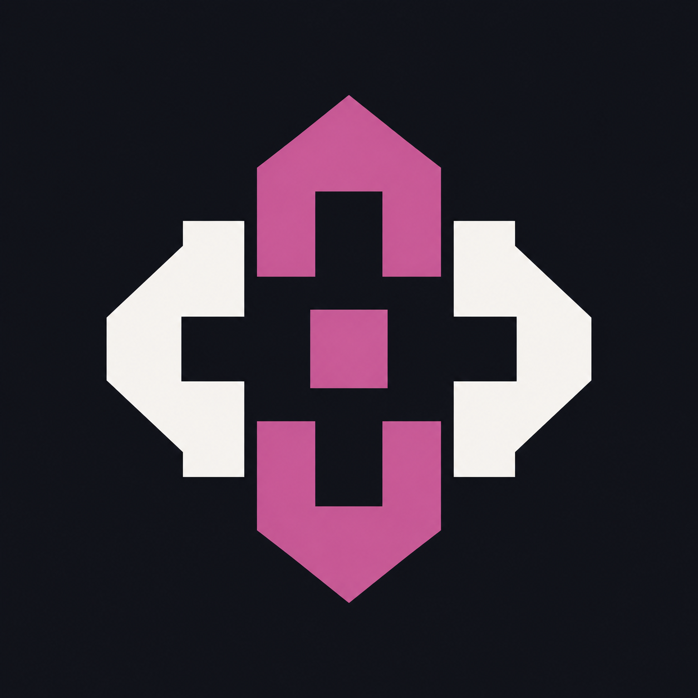

# Berkin Efe Avcı

Architecture, software and visual production. I build practical tools and explore spatial and visual ideas, with AI as part of my research, development and production process.

**[Portfolio · Portfolyo](https://berkinefeavci.github.io)** · **[English](https://berkinefeavci.github.io/en/)** · [Contact](mailto:berkin.mimar@gmail.com)

Mimarlık, yazılım ve görsel üretim arasında çalışıyorum. Yayınlanmış uygulamalar, web işleri, mimari ön tasarımlar ve AI destekli görsel çalışmalarım portfolyoda bir arada.

## Applications

| Project | Work | Links |
| --- | --- | --- |
| Healthy Battery | Battery health and charging control for your MacBook, in one place. **Open source.** | [Details](https://berkinefeavci.github.io/en/#healthy-battery) · [Website](https://healthybatteryapp.com) · [GitHub](https://github.com/berkinefeavci/healthy-battery) |
| Flower | From watching to practising. Slow down, mirror and loop dance clips. **iOS.** | [Details](https://berkinefeavci.github.io/en/#flower) · [Website](https://apps.apple.com/us/app/flower-daily-dance-practice/id6767139817) |
| Portside | A memory for local servers. See what's running and bring it back. **Open source.** | [Details](https://berkinefeavci.github.io/en/#portside) · [Website](https://portsidemac.com) · [GitHub](https://github.com/berkinefeavci/portside) |
| SayWords | Dictation that turns speech into text and fits into everyday work. **macOS.** | [Details](https://berkinefeavci.github.io/en/#saywords) · [Website](https://saywordsapp.com) · [GitHub](https://github.com/berkinefeavci/saywords) |
| PanelLight | Display brightness, right in your menu bar. **Open source.** | [Details](https://berkinefeavci.github.io/en/#panellight) · [Website](https://panellightapp.com) · [GitHub](https://github.com/berkinefeavci/PanelLight) |
| Sticker Studio | Stickers, calendars and small interactions that make a desktop personal. **macOS.** | [Details](https://berkinefeavci.github.io/en/#sticker-studio) · [Website](https://stickerstudioapp.com) · [GitHub](https://github.com/berkinefeavci/sticker-studio) |

## Web & automation

| Project | Work | Links |
| --- | --- | --- |
| Kaptan Yangın | A product and contact-focused website for fire safety services. **Website.** | [Details](https://berkinefeavci.github.io/en/#kaptan-web) · [Website](https://7kaptan.com) · [GitHub](https://github.com/berkinefeavci/kaptan-site) |
| TURK-ISHI CAMP | An event website bringing a dance camp's identity to the web. **Website.** | [Details](https://berkinefeavci.github.io/en/#turkish-camp) · [Website](https://turkishicamp.com) · [GitHub](https://github.com/berkinefeavci/turkishicamp-site) |
| Thrust Rush | A browser game experiment between driving, flight and flips. **Game demo.** | [Details](https://berkinefeavci.github.io/en/#thrust-rush) · [Website](https://oyun.7kaptan.com) |
| AVCI Operasyon | Bringing multiple business workflows into one operations interface. **Private project.** | [Details](https://berkinefeavci.github.io/en/#avci-operasyon) |
| Perde | Film and series discovery, a personal library and a phone remote experience. **Personal project.** | [Details](https://berkinefeavci.github.io/en/#perde) |

## Architecture

| Project | Work | Links |
| --- | --- | --- |
| Volleyball Hall | Structure, light and context for a sports hall. Alternative designs for a 700 m² programme. **Preliminary design.** | [Details](https://berkinefeavci.github.io/en/#voleybol) |
| Kaptan Yangın Building | A phased building concept connecting present needs with future uses. **Concept study.** | [Details](https://berkinefeavci.github.io/en/#kaptan-bina) |

## Visual work

| Project | Work | Links |
| --- | --- | --- |
| Rüya Postası | Impossible scenes from a familiar city. A surreal Istanbul series. **Visual series.** | [Details](https://berkinefeavci.github.io/en/#ruya-postasi) |

## Open-source contribution

[DockDoor preview-title fix](https://github.com/ejbills/DockDoor/pull/1618).

---

Architectural work shown here is conceptual or preliminary, not completed construction. AI-assisted imagery is labelled. Private project code and customer data are not published.
